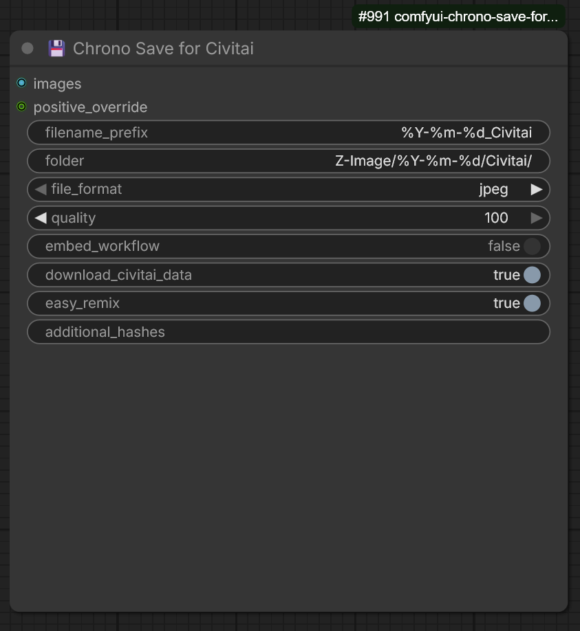

# 💾 Chrono Save for Civitai

A ComfyUI custom node that saves images with **full Civitai-compatible metadata** — auto-detected from your workflow. No manual wiring needed.

Upload your images to Civitai and it automatically detects your **checkpoint, LoRAs, prompt, sampler, steps, seed**, and everything else.

## Features

- **Auto-detects everything** — model, LoRAs, sampler, scheduler, steps, CFG, seed, prompt, image size. Only the `images` input needs connecting.
- **Civitai resource linking** — calculates SHA256 hashes and fetches Civitai resource data so uploads show the correct checkpoint and LoRAs.
- **No workflow leak** — saves as JPEG/WebP/PNG with only the generation metadata. Your workflow stays private.
- **strftime folder & filename** — organize outputs with date-based paths like `IL/%Y-%m-%d/CivitSave/`.
- **Works with any node setup** — standard KSampler, Flux (SamplerCustomAdvanced + CFGGuider + BasicScheduler), Ultimate SD Upscale, custom checkpoint loaders, Power Lora Loader (rgthree), and more.

## Supported Loaders

| Node | Detected |
|------|----------|
| CheckpointLoaderSimple | ✅ |
| Checkpoint Loader (comfyui-custom-scripts) | ✅ |
| UNETLoader / Load Diffusion Model | ✅ |
| UnetLoaderGGUF | ✅ |
| LoraLoader / LoraLoaderModelOnly | ✅ |
| Power Lora Loader (rgthree) | ✅ |
| LoRA Stacker / easy loraStack | ✅ |

## Installation

Clone into your ComfyUI custom nodes directory:

```bash
cd ComfyUI/custom_nodes/
git clone https://github.com/KChronoKnight/Chrono-Save-for-Civitai.git
```

Restart ComfyUI. The node appears under the **chrono-save-for-civit** category.

### Requirements

Install dependencies:

```bash
pip install -r requirements.txt
```

## Screenshot



## Usage

1. Add **Chrono Save for Civitai** to your workflow
2. Connect **images** from your VAE Decode (or upscaler, etc.)
3. Optionally connect **positive_override** from a text node if you want to specify the exact prompt (useful with batch prompt workflows)
4. Set your preferred folder and filename format
5. Queue and go — metadata is captured automatically

### Node Inputs

| Input | Description |
|-------|-------------|
| `images` | The image(s) to save. **Only required connection.** |
| `filename_prefix` | Filename pattern. Default: `%Y-%m-%d_Civitai` |
| `folder` | Subfolder under ComfyUI output. Default: `Zimage/%Y-%m-%d/Civitai/` |
| `file_format` | `jpeg`, `png`, or `webp` |
| `quality` | JPEG/WebP quality, 1–100 |
| `embed_workflow` | `false` = no workflow in image (private). `true` = embed workflow. |
| `download_civitai_data` | Fetch resource info from civitai.com for proper linking |
| `easy_remix` | Strip LoRA tags from prompt for cleaner Civitai remix |
| `positive_override` | (optional) Override the auto-detected positive prompt |
| `additional_hashes` | (optional) Extra resource hashes, comma-separated `Name:HASH` |

### Filename & Folder Placeholders

| Placeholder | Replacement |
|-------------|-------------|
| `%Y` | Year (2026) |
| `%y` | Year short (26) |
| `%m` | Month (01–12) |
| `%d` | Day (01–31) |
| `%H` | Hour (00–23) |
| `%I` | Hour (00–12) |
| `%p` | AM/PM |
| `%M` | Minute (00–59) |
| `%S` | Second (00–59) |
| `%seed` | Generation seed |
| `%model` | Model name |

**Example:** `folder: Zimage/%Y-%m-%d/Civitai/` and `filename_prefix: %Y-%m-%d_Civitai` produces:
```
output/Zimage/2026-05-02/Civitai/2026-05-02_Civitai.jpg
```

## Example Terminal Output

Each save prints a summary to the ComfyUI console so you can verify what was detected:

```
============================================================
  CHRONO SAVE FOR CIVITAI — Auto-detected metadata:
  Model:     hassakuXLIllustrious_v13StyleA
  Sampler:   Euler a
  Steps:     20  |  CFG: 3.5  |  Seed: 1353203726889791
  Size:      832x1216
  Prompt:    masterpiece, best quality, good quality, very aesthetic...
  Hash:      a1b2c3d4e5
  Hashes:    {"model":"a1b2c3d4e5","lora:ck-shadow-circuit-IL":"f6g7h8i9j0"}
  LoRAs:     3 detected: ck-shadow-circuit-IL, MoriiMee_Gothic, ck-nc-cyberpunk-IL
  Civitai:   4 resource(s) detected
============================================================
```

## Performance Note

The first time you use a checkpoint or LoRA, the node calculates its SHA256 hash — this can take a few seconds per file. A `.sha256` cache file is saved next to each model so subsequent runs are instant.


## License

MIT
